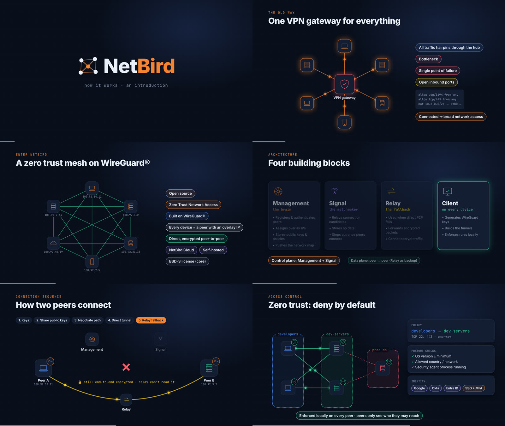

# ai-explainer

[](https://github.com/fahim-choudhury/ai-explainer/actions/workflows/ci.yml)

An AI agent produces an animated explainer video with you: research, script, narration, subtitles, animated diagrams, final render, and a ready-to-paste YouTube and social package. You approve each stage at a review gate, then upload and post yourself.

The workflow works with any agent that can run shell commands and edit files: Claude Code, Codex, Gemini CLI, Cursor, OpenCode and others. The agent follows [AGENTS.md](AGENTS.md). Every production step is a command in `bin/xv` (short for explainer video), so the same script and settings give the same files whichever agent runs them.

- Narration: [Kokoro](https://huggingface.co/hexgrad/Kokoro-82M) text-to-speech, run locally
- Pronunciation check: [faster-whisper](https://github.com/SYSTRAN/faster-whisper), run locally
- Animation and rendering: [Remotion](https://www.remotion.dev) (React)
- No cloud APIs and no accounts. Nothing is uploaded anywhere, and rendering works offline once `./setup` has run.



*Scene stills from [NetBird explained](https://youtu.be/2e-DbSTCIwA), a video made with this workflow. The agent shows you sheets like this at the visuals gate.*

Narration, the pronunciation check and the narration lint rules are English only for now.

## Requirements

Linux on x86_64 or arm64. On Windows, use WSL.

`./setup` checks for these system tools and does not install them:

| Tool | Fedora | Debian or Ubuntu |
| --- | --- | --- |
| git, curl, tar | `dnf install git curl tar` | `apt install git curl tar` |
| ffmpeg | `dnf install ffmpeg` (RPM Fusion) | `apt install ffmpeg` |
| Node.js 20 or newer, with npm | `dnf install nodejs` | `apt install nodejs npm`, or [nodejs.org](https://nodejs.org) |

Remotion's headless browser needs the usual Chromium libraries. If `xv selftest` fails to render a still, install them. On Ubuntu 24.04, as the CI workflow does: `apt install libnss3 libdbus-1-3 libatk1.0-0 libatk-bridge2.0-0 libgbm1 libasound2t64 libxrandr2 libxkbcommon0 libxfixes3 libxcomposite1 libxdamage1 libpango-1.0-0 libcairo2 libcups2 libdrm2` (`libasound2` before 24.04).

About 2 GB of disk for the downloads.

## Setup

```sh
git clone https://github.com/fahim-choudhury/ai-explainer.git
cd ai-explainer
./setup
```

`./setup` downloads everything else into the repository and checks it:

| Step | Pinned by | Goes to |
| --- | --- | --- |
| uv, verified by SHA256 | `deps/tools.json` | `.tools/uv` |
| Python | `deps/tools.json` | `.tools/python/` |
| Python packages | `uv.lock` | `.venv/` |
| Node packages | `package-lock.json` | `node_modules/` |
| Remotion's headless browser | the Remotion version | `node_modules/.remotion/` |
| Kokoro and Whisper models, verified by SHA256 | `deps/models.json` | `models/` |

Then it runs `xv doctor`, which checks all of the above against the lockfiles and writes a verification stamp, and `xv selftest`, which takes a throwaway project through narration, the Whisper check, linting, a type check and two stills. Every `xv` command that uses a dependency refuses to run until `xv doctor` has passed, and again after any lockfile changes.

Rerunning `./setup` is safe; it skips what is already correct.

Unit tests for the lint rules, chapters, ASR normalisation and project state commands need no models: `.venv/bin/python -m pytest`. CI runs them, and runs `./setup` from empty on Ubuntu, on every push and weekly.

## Workspace

Videos live outside the repository. Pick a folder:

```sh
cp xv.toml.example xv.toml    # then set workspace = "~/Videos/explainers"
# or
export XV_WORKSPACE=~/Videos/explainers
```

A `workspace` line in `~/.config/xv/config.toml` works too, for all clones. `--workspace DIR` on any command overrides all of these. Without any of them, videos go to `workspace/` in the repository, which git ignores.

## Using it with an agent

Start your agent in this repository and ask for an explainer video on a topic. Agents that read `AGENTS.md` pick up the workflow on their own. `CLAUDE.md` and `GEMINI.md` point there for Claude Code and Gemini CLI.

For Claude Code, you can also install the workflow as a skill, so it works from any folder:

```sh
ln -s "$PWD/agents/claude/skills/explainer-video" ~/.claude/skills/explainer-video
```

[GUIDE.md](GUIDE.md) covers the stages, how to review, autopilot, and the social media playbook.

## The xv command

`bin/xv` follows the [Command Line Interface Guidelines](https://clig.dev): `xv help <command>` for options and examples, results on stdout and progress on stderr, `--json` on the commands an agent reads, `-n`/`--dry-run` on the ones that commit, and documented exit codes. `xv --help` lists everything.

## Uninstall

Delete the repository folder. Everything `./setup` downloaded lives inside it. Two caches live outside: uv's package cache (`~/.cache/uv`, shared with other uv projects) and, only for repositories in deep folders, `~/.cache/xv-espeak-ng-data`. Your video projects stay in the workspace.

## Licenses

This repository is MIT-licensed; see [LICENSE](LICENSE). Remotion has its own license: free for individuals and companies of up to 3 people, paid above that. [STYLE.md](STYLE.md) is adapted from The Writing Whip by Ossama Chaib ([tropes.fyi](https://tropes.fyi)), under CC BY 4.0. [THIRD_PARTY.md](THIRD_PARTY.md) lists every third-party component and its terms.
